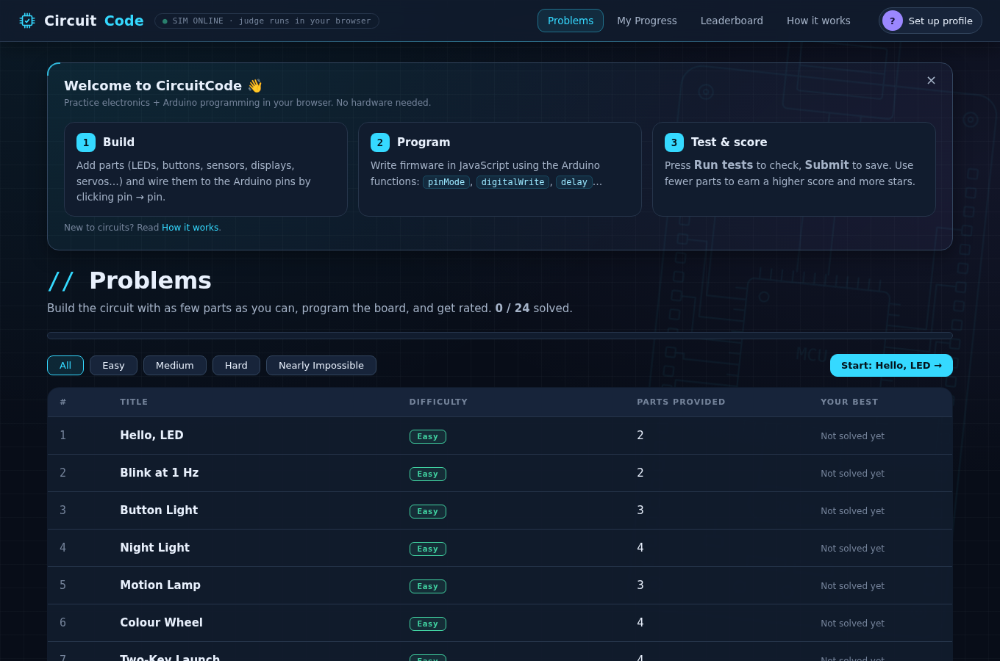
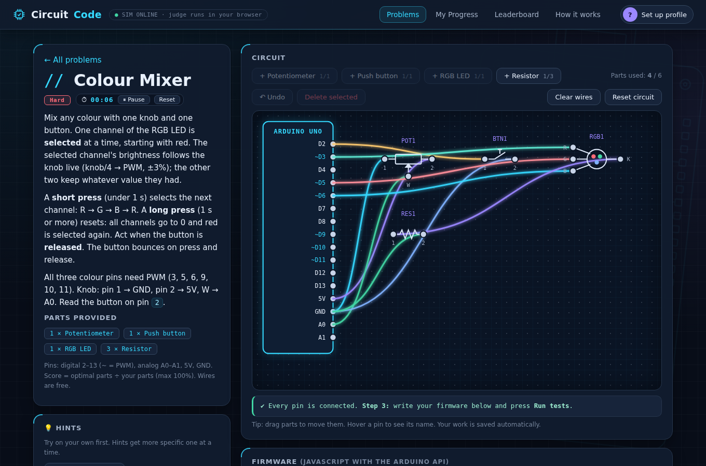
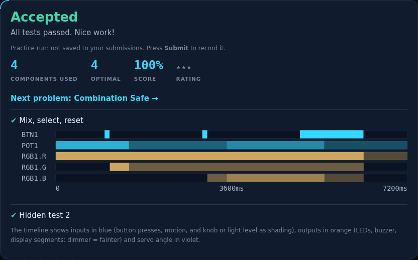
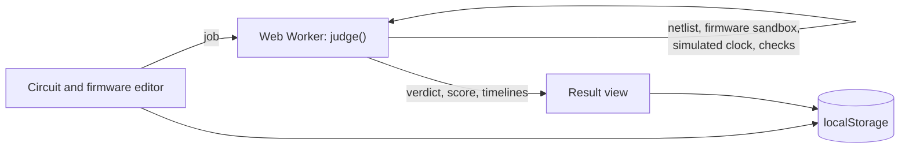

# CircuitCode

**Practise Arduino circuits and firmware in your browser, judged like a programming contest.**

CircuitCode is LeetCode for hardware. Pick a problem, place parts on a virtual board, wire them to an Arduino Uno, and write the firmware. A deterministic simulator runs your build against visible and hidden test cases and returns a verdict, a score and a timeline of every output. Fewer parts earn a higher score, so clever circuits win.



## Features

- **24 problems** across four difficulties, from lighting an LED to a multiplexed two-digit scoreboard.
- **11 component types:** LED, resistor, push button, buzzer, potentiometer, photoresistor, PIR motion sensor, RGB LED, 7-segment display, servo, 74HC595 shift register.
- **Real failure modes:** the judge detects burned LEDs, short circuits, floating inputs, contact bounce, non-PWM pins, unpowered modules and LEDs that load a sensor divider.
- **Arduino API in JavaScript:** `pinMode`, `digitalWrite/Read`, `analogRead/Write`, `delay`, `millis`, `Servo`, `shiftOut`, `map`, `constrain`, `Serial`.
- **Instant feedback:** verdicts (Accepted, Wrong Answer, Invalid Circuit, Compile Error, Runtime Error, Time Limit Exceeded), part-count score, stars, per-test timelines and progressive hints.
- **Progress tracking:** per-problem stopwatch, submission history, points and a leaderboard.
- **Zero install:** one HTML file, no build, no server, no dependencies. It works offline.

| Circuit editor | Verdict and timeline |
|---|---|
|  |  |

## Quick start

### Option 1: just open it

Download or clone the repo and open `index.html` in Chrome, Edge, Firefox or Safari.

### Option 2: run the local server

Requires **Node.js 18 or newer**. There is nothing to install.

```bash
git clone <repository-url> circuitcode
cd circuitcode
cp .env.example .env      # optional: change PORT/HOST
npm start                 # → http://127.0.0.1:8080/
```

Serving over HTTP is recommended: some browsers block Web Workers on `file://`. In that case the app falls back to judging on the main thread, without the 8-second infinite-loop watchdog.

## Environment variables

The app in the browser needs **no configuration**. These variables configure the dev server and the Node.js tooling. Set them in your shell or in a `.env` file (copy `.env.example`). Shell values take precedence over `.env`.

| Variable | Default | Used by | Description |
|---|---|---|---|
| `PORT` | `8080` | `npm start` | Port for the local static server |
| `HOST` | `127.0.0.1` | `npm start` | Interface to bind; use `0.0.0.0` to open it to your LAN |
| `CC_APP` | `index.html` | tests, `judge`, `catalog` | App file whose judge and problem bank are loaded (point it at a work-in-progress copy) |
| `CC_FILTER` | *(empty)* | `npm run test:samples` | Run only samples whose problem id or file name contains this text |
| `CC_VERBOSE` | `0` | `npm run judge` | `1` also prints wiring warnings |

## Scripts

| Command | What it does |
|---|---|
| `npm start` | Serve the app locally |
| `npm test` | Run all tests (engine, problem bank, sample data) |
| `npm run test:engine` | Simulator and judge unit tests only |
| `npm run test:samples` | Judge every file in `samples/` |
| `npm run judge -- <file.json>…` | Judge sample files and print the verdict for each test |
| `npm run catalog` | Regenerate `samples/problems.json` and `docs/PROBLEMS.md` |

## Testing

```bash
npm test
```

There are 93 tests on Node's built-in runner (`node:test`), with no dependencies:

- **Engine** (`tests/engine.test.mjs`): button bounce, scoring, LED polarity, burn and short detection, pull-ups and pull-downs, floating inputs, potentiometer and LDR readings, PWM, servo, shift register, 7-segment decoding, every verdict type and the firmware sandbox.
- **Problem bank** (`tests/bank.test.mjs`): ids, difficulty order, part types, reachable optimal score, visible and hidden tests, hints, self-contained checkers.
- **Samples** (`tests/samples.test.mjs`): all 24 reference solutions are Accepted at the optimal part count, and 13 common mistakes are rejected with the right verdict and message.

The tests load the judge **straight out of `index.html`**, so CI checks exactly the code users run. CI runs on GitHub Actions (`.github/workflows/ci.yml`) and GitLab CI (`.gitlab-ci.yml`) with Node 18, 20 and 22.

## Sample data

See [`samples/README.md`](samples/README.md). In short:

- `samples/problems.json` is the problem catalog.
- `samples/solutions/` holds a reference solution for every problem (spoilers!).
- `samples/negative/` holds common mistakes with the verdicts the judge must return.

## Project structure

```
circuitcode/
├── index.html                 # The entire app: UI + judge + problem bank
├── docs/
│   ├── TECHNICAL_DESIGN.md    # Architecture, diagrams, simulation model, decisions
│   ├── PROBLEMS.md            # Generated problem catalog
│   └── screenshots/
├── samples/
│   ├── problems.json          # Generated catalog (machine-readable)
│   ├── solutions/             # 24 reference solutions
│   └── negative/              # 13 common-mistake cases
├── scripts/
│   ├── serve.mjs              # Zero-dependency dev server
│   ├── load-engine.mjs        # Loads judge + problems from index.html into Node
│   ├── judge-cli.mjs          # Judge sample files from the terminal
│   ├── catalog.mjs            # Regenerates the catalog
│   └── env.mjs                # .env loader and config
├── tests/                     # node:test suites
├── .github/workflows/ci.yml   # GitHub Actions: test + Pages deploy
├── .gitlab-ci.yml             # GitLab CI: test + Pages deploy
├── .env.example
├── CONTRIBUTING.md
└── LICENSE
```

## Architecture at a glance



The full design (component and sequence diagrams, the digital and analogue circuit model, time model, sandbox, data model, deployment and roadmap) is in **[docs/TECHNICAL_DESIGN.md](docs/TECHNICAL_DESIGN.md)**.

## Deployment

It is a static site, so serve `index.html` from anywhere.

- **GitHub Pages:** in *Settings → Pages*, set the source to *GitHub Actions*. The `pages` job in CI deploys on every push to `main` after the tests pass.
- **GitLab Pages:** the `pages` job in `.gitlab-ci.yml` publishes on the default branch.
- **Anything else** (Netlify, Vercel, S3, a USB stick): copy `index.html`.

## Data and privacy

Everything is stored in your browser's `localStorage`: your circuits, code, submissions, profile and the leaderboard. Nothing is sent to a server. The only network request is for Google Fonts, and the app falls back to system fonts offline.

## Known limitations

- Hidden tests ship inside the page, so a determined user can read them. A server-side judge is on the roadmap.
- The leaderboard is local to each browser.
- Firmware is JavaScript with Arduino function names, not compiled C++.
- The electrical model is simplified: every fixed resistor counts as 10 kΩ and LED forward voltage is ignored.

## Contributing

See [CONTRIBUTING.md](CONTRIBUTING.md), including the step-by-step guide to adding a problem or a new part type.

## License

[MIT](LICENSE)
