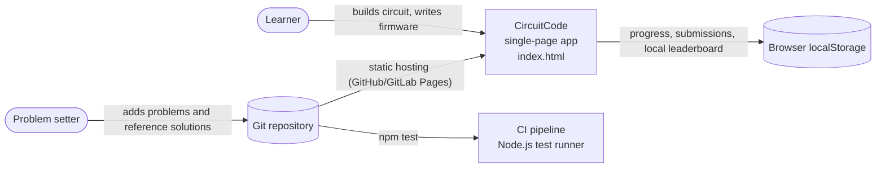
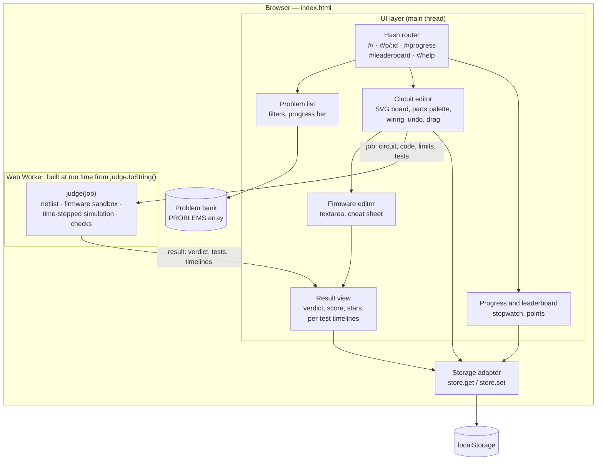
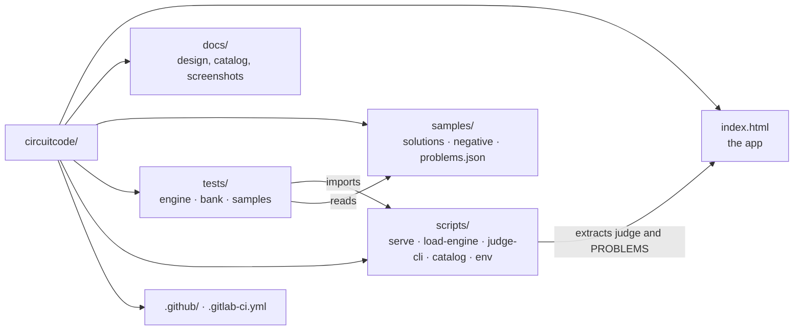
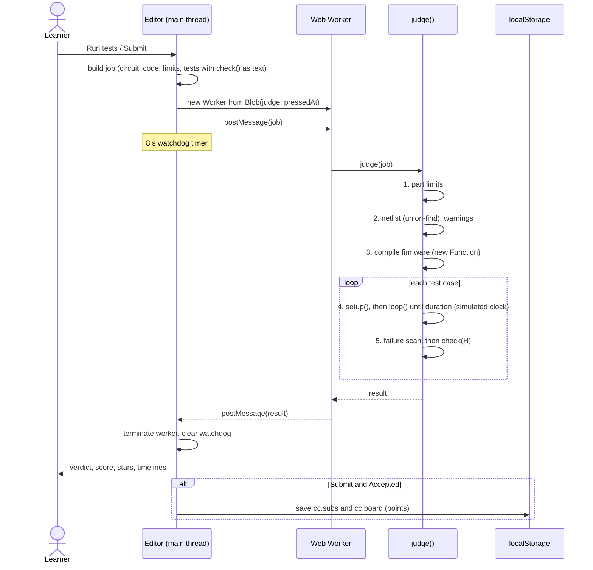
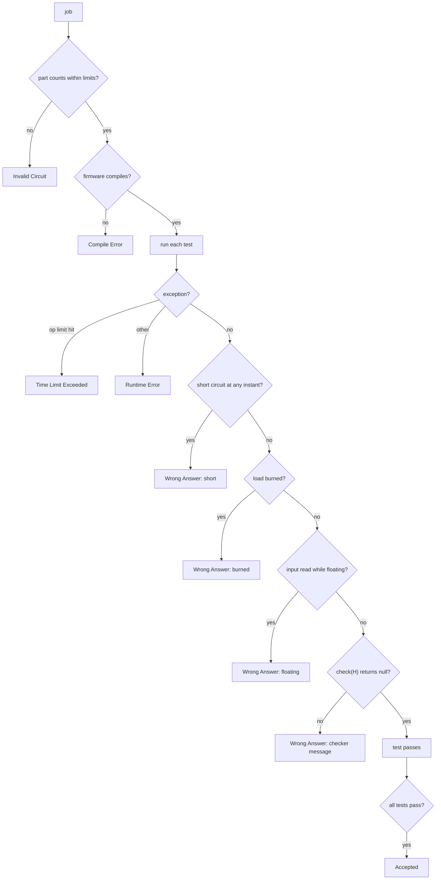
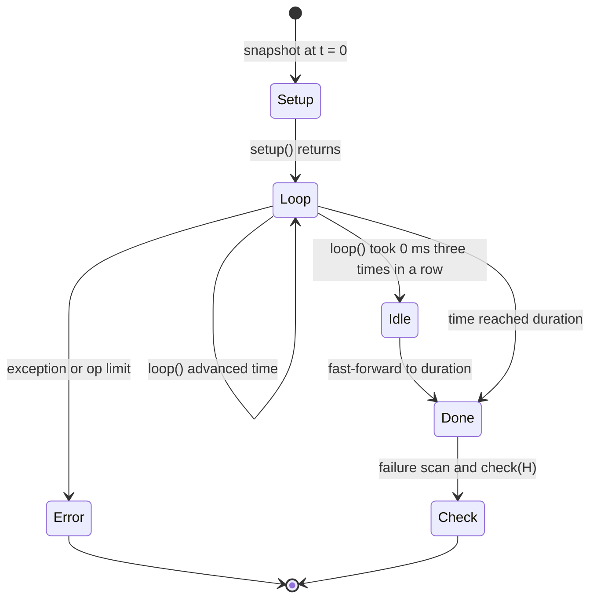
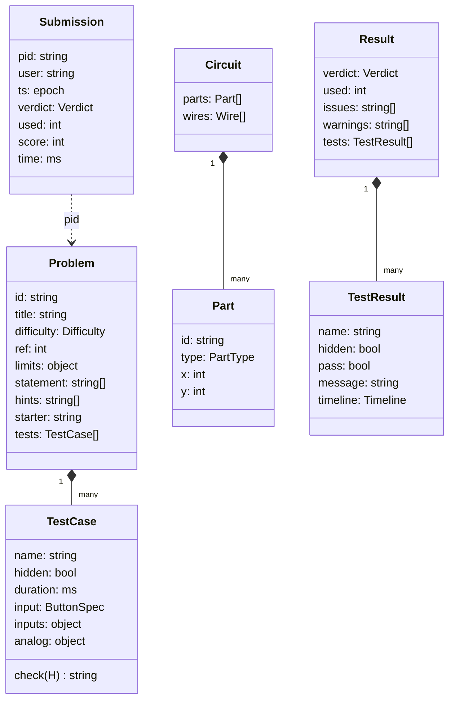
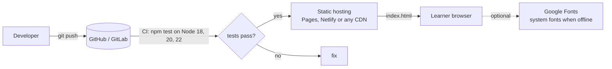

# CircuitCode — Technical Design Document

| | |
|---|---|
| **Product** | CircuitCode: a browser-based practice platform for Arduino circuits and firmware |
| **Version** | 1.0.0 |
| **Status** | Working prototype |
| **Audience** | Contributors, reviewers and problem setters |

Diagrams are written in [Mermaid](https://mermaid.js.org/) and render natively on GitHub and GitLab.

---

## 1. Overview

CircuitCode works like a competitive-programming judge, but for hardware. A learner opens a problem, places parts (LEDs, resistors, buttons, sensors, displays, a servo, a shift register) on a virtual breadboard, wires them to a virtual Arduino Uno, and writes firmware using the Arduino API. A deterministic simulator then runs the circuit and firmware against visible and hidden test cases. It returns a verdict (Accepted, Wrong Answer, …), a score based on how few parts were used, and a timeline of what every output did.

### 1.1 Goals

- **No hardware, no install.** Everything runs in one HTML file in any modern browser, offline.
- **Deterministic judging.** The same circuit and firmware always give the same verdict. Time is simulated rather than measured on the wall clock.
- **Realistic failure modes.** The judge catches burned LEDs, short circuits, floating inputs, contact bounce, non-PWM pins and loaded voltage dividers, so learners hit the same mistakes a real bench would show them.
- **Optimisation incentive.** Score = optimal part count ÷ parts used, which rewards clever circuits such as shared resistors, Charlieplexing and multiplexing.
- **Easy to extend.** A problem is plain data plus a `check()` function. Adding a problem needs no change to the engine.

### 1.2 Non-goals (prototype)

- Analogue circuit simulation at SPICE level (no transient behaviour, LED forward voltage or current ratings).
- Compiling real C++ Arduino sketches. Firmware is written in JavaScript with the same function names.
- A server-side judge, accounts, or a shared leaderboard. See §12 for the planned path.

---

## 2. System context



The deployable artefact is one static file. CI uses the same file: Node extracts the judge and problem bank from `index.html`, so the browser and the tests can never drift apart.

---

## 3. Architecture

### 3.1 Component view



### 3.2 Source layout inside `index.html`

The single file has three logical modules in one `<script>`, in this order:

| Module | Responsibility | Key symbols |
|---|---|---|
| **judge.js** | Pure, self-contained simulator and judge. It has no DOM access, so it can be stringified into a Web Worker and loaded in Node. | `judge(job)`, `pressedAt(spec, t)`, `scoreFor`, `ratingFor` |
| **problems.js** | Problem bank: statements, hints, part limits, optimal part count, test cases with `check()` functions. Sorted by difficulty at load time. | `PROBLEMS`, `DIFF_ORDER` |
| **app (IIFE)** | UI: routing, editor, worker management, results, persistence, leaderboard. | `PART_DEFS`, `draw()`, `run()`, `runJudge()`, `route()` |

Each module ends with `if (typeof module !== 'undefined') module.exports = …`. That is the seam `scripts/load-engine.mjs` uses to load the first two modules in Node.

### 3.3 Repository layout



---

## 4. Judging pipeline

### 4.1 Sequence: pressing *Run tests*



If the worker does not answer within 8 s, the main thread terminates it and reports **Time Limit Exceeded**. If `Worker` is unavailable (some `file://` setups), `judge()` runs inline as a fallback without the watchdog.

### 4.2 Verdict precedence



Hidden tests report only "Failed a hidden test case.", so the checker's details stay secret. Electrical faults (short, burn, floating) are always reported in full because they describe the learner's own circuit.

---

## 5. Circuit model

### 5.1 Netlist

- Every pin is a key: `mcu.D3`, `mcu.5V`, `mcu.A0`, `LED1.A`, `SR1.Q4`, …
- Wires merge keys into **nets** with union-find (path halving).
- **Edges** between nets: resistors, both halves of a potentiometer and photoresistors (resistive, `r: true`), plus buttons while pressed (zero resistance, `r: false`). LEDs are *not* edges: current cannot flow through an unlit diode backwards, and a lit one is modelled in the analogue pass only.

### 5.2 Digital solve (every state change)

1. **Sources.** H = {5V, OUTPUT pins written HIGH (including PWM > 0), powered PIR outputs during motion, powered shift-register outputs at 1}. L = {GND, OUTPUT pins written LOW, the same outputs at 0}.
2. **Reachability.** `reach(sources, edges)` floods the nets each source set can reach and tracks whether a path has **zero resistance** (`noR`).
3. **Loads.** An LED, buzzer, RGB channel or display segment is **on** when its anode is H-reachable and its cathode is L-reachable. It is **burned** if both paths are zero-resistance.
4. **Short.** A net that is both H-reachable and L-reachable with zero resistance on both sides.
5. **Brightness.** 1 if a full source reaches the anode, otherwise the strongest PWM duty that does.

### 5.3 Analogue solve (on demand)

`analogRead`, and any `digitalRead` of a net that both H and L reach through resistance (a divider), use nodal analysis:

- **Fixed nodes:** 5V = 5 V, GND = 0 V, OUTPUT pins (PWM pin = 5 × duty), powered sensor and chip outputs.
- **Conductances:**

  | Element | Value |
  |---|---|
  | Fixed resistor | 10 kΩ |
  | Potentiometer | 10 kΩ total, split at the knob position |
  | Photoresistor | 1 kΩ × 100^(1 − light), from 1 kΩ (bright) to 100 kΩ (dark) |
  | Pressed button | 1 Ω |
  | `INPUT_PULLUP` | 35 kΩ to 5V |
  | Lit LED | 1 kΩ |

- The connected component of unknown nodes around the target net is collected by breadth-first search, stopping at fixed nodes. If it touches no fixed node, the input is **floating**. Otherwise **G·v = b** is solved with Gaussian elimination and partial pivoting.
- `analogRead` returns `round(V / 5 × 1023)`. `digitalRead` uses a 2.5 V threshold.

Modelling a lit LED as a load is deliberate. It stops the "hang the LED on the sensor divider to save a resistor" trick, which would not work on real hardware either.

### 5.4 Parts

| Type | Pins | Behaviour in the model |
|---|---|---|
| `LED`, `BUZ` | A, K | Load (on/off, brightness) |
| `RES` | 1, 2 | Resistive edge, 10 kΩ in the analogue pass |
| `BTN` | 1, 2 | Zero-resistance edge while pressed; timeline with bounce |
| `POT` | 1, W, 2 | Two resistive edges; knob position from the test's `analog` timeline |
| `LDR` | 1, 2 | Resistive edge; light level from the test's `analog` timeline |
| `PIR` | V, O, G | Push-pull output on O while V–5V and G–GND are wired; motion windows from `inputs` |
| `RGB` | R, G, B, K | Three loads sharing K |
| `SEG` | a–g, K | Seven loads sharing K; checks can decode digits |
| `SRV` | S, V, G | Angle from `Servo.write()` when powered and S is on the attached pin |
| `SR` (74HC595) | DS, SH, ST, VCC, GND, Q0–Q7 | 8-bit shift on SH rising edge, latch on ST rising edge, push-pull Q outputs |

Optional pins (unused RGB channels, segments, Q outputs) do not raise "not connected" warnings.

---

## 6. Time and execution model



- **Simulated clock.** Time advances only through the API. `delay(ms)` advances by `ms`; every other API call costs 0.01 ms, so busy loops still make progress. Inputs (buttons, PIR, analogue signals) are sampled per 1 ms step inside `delay`, and a change triggers a snapshot.
- **Snapshots.** After every state change the judge records `{t, leds, burned, short, pins, angles}`, but only when something differs from the previous snapshot. Checks query them with binary search.
- **Shift register.** `chipTick()` runs after every pin change. It samples DS/SH/ST and applies rising edges, so `shiftOut()` and hand-written bit-banging behave identically.
- **Limits.** 2.5 million API operations per test (raises **Time Limit Exceeded**), plus the 8 s worker watchdog.

---

## 7. Firmware sandbox

Firmware is compiled with `new Function(...)`. Its parameters are the Arduino API, plus `undefined` placeholders that shadow `fetch`, `XMLHttpRequest`, `importScripts`, `postMessage`, `self`, `globalThis`, `WebSocket`, `indexedDB`, `localStorage`, `document` and `window`.

| API | Notes |
|---|---|
| `pinMode`, `digitalWrite`, `digitalRead` | Pins 2–13, plus A0/A1 (14/15) |
| `analogRead(A0 \| A1)` | 0–1023 from the analogue solve |
| `analogWrite(pin, 0–255)` | PWM pins 3, 5, 6, 9, 10, 11 only |
| `delay`, `millis` | Simulated clock |
| `new Servo()` → `attach`, `write`, `read`, `detach` | Angle 0–180 |
| `shiftOut(data, clock, MSBFIRST \| LSBFIRST, v)` | 8 clock pulses |
| `map`, `constrain` | Arduino integer semantics |
| `Serial.print/println` | Captured into `H.logs` for checks |

**Security note.** Shadowing globals is a convenience, not a security boundary. The real isolation is the Web Worker: it has no DOM, cookies or page `localStorage`, it is terminated after each run, and it runs only the learner's own code in the learner's own browser. A hosted, multi-user judge must run in a server-side sandbox (§12).

---

## 8. Problem format

```js
{
  id: 'porch-light',                    // URL slug, unique
  title: 'Porch Light',
  difficulty: 'Hard',                   // Easy | Medium | Hard | Nearly Impossible
  ref: 5,                               // parts in the best-known solution (score = ref / used)
  limits: { PIR: 1, LDR: 1, LED: 1, RES: 2 },
  statement: ['…markdown-lite paragraphs…'],
  hints: ['progressive', 'more specific', 'almost the answer'],
  starter: 'function setup() {}\nfunction loop() {}\n',
  tests: [{
    name: 'A night on the porch',
    hidden: false,
    duration: 9000,                                     // ms of simulated time
    input:  { windows: [[s, e]], bounce: 6, seg: 2 },   // default timeline for every button
    inputs: { BTN2: {…}, PIR1: { windows: [[300, 500]] } },   // per-part timelines
    analog: { LDR1: [[0, 1], [1000, 0.1]], POT1: [[0, 0.5]] }, // step functions, 0..1
    check: function (H) { return null /* pass */ || 'message' /* fail */; }
  }]
}
```

`check()` is stringified into the worker, so it must be self-contained (no closures). `tests/bank.test.mjs` enforces this.

### 8.1 Checker helper `H`

| Helper | Returns |
|---|---|
| `H.on(id, t)`, `H.anyOn(t)`, `H.count(t)`, `H.lit(t)` | Load state at time t (`id` like `LED1`, `RGB1.R`, `SEG1.g`) |
| `H.level(id, t)` | Brightness 0–1 (PWM) |
| `H.duty(id, a, b)`, `H.gap(id, a, b)` | Fraction of time on; longest dark stretch (ms). Used for flicker checks |
| `H.digit(id, t)` | Character shown by a 7-segment display (`' '` = blank, `'?'` = garbled) |
| `H.shown(id, a, b)` | Steady digit over a window for multiplexed displays (`'~'` = flicker or dim) |
| `H.angle(id, t)` | Servo angle, or `null` if unpowered or not attached |
| `H.pin(p, t)`, `H.read(p)`, `H.used()` | Output level, whether firmware read a pin, pins touched |
| `H.has(prefix)`, `H.ids`, `H.logs` | Part presence, all load ids, Serial output |

---

## 9. Data model and persistence



All state lives in `localStorage`, behind a `try/catch` adapter so private-mode browsers degrade gracefully:

| Key | Contents |
|---|---|
| `cc.user` | Profile: display name, GitHub handle, photo URL |
| `cc.p.<problemId>` | Saved circuit (parts with positions, wires) and firmware |
| `cc.h.<problemId>` | Number of hints revealed |
| `cc.t.<user>.<problemId>` | Stopwatch milliseconds |
| `cc.subs` | Last 300 submissions (all users on this browser) |
| `cc.board` | Leaderboard: best score per problem per user |
| `cc.welcomeHidden` | Welcome banner dismissed |

Points per problem = difficulty base (Easy 100, Medium 200, Hard 300, Nearly Impossible 500) × score %. Ties are broken by total time.

---

## 10. Deployment



There is no build step. Hosting is "serve `index.html`". Locally, `npm start` runs a zero-dependency static server (`scripts/serve.mjs`).

---

## 11. Testing strategy

| Suite | File | What it proves |
|---|---|---|
| Engine unit tests | `tests/engine.test.mjs` | Input bounce model, scoring, LED polarity, burn, short, floating, pull-up and pull-down, multi-button timelines, potentiometer and LDR readings, LED loading a divider, PWM brightness and pin rules, servo power and attachment, 74HC595 shift/latch, 7-segment decoding, every verdict type, sandbox blocking `fetch` |
| Bank integrity | `tests/bank.test.mjs` | Unique URL-safe ids, sorted difficulties, all four difficulties present, known part types, `ref` reachable, visible + hidden tests, ≥ 2 hints, self-contained checks |
| Sample data | `tests/samples.test.mjs` | All 24 reference solutions are Accepted at exactly the optimal part count (100%); 13 common-mistake samples fail with the expected verdict and message |

Tests run in Node's built-in runner (`node:test`) with **zero dependencies**, against the *same* `index.html` that ships.

---

## 12. Limitations and roadmap

| Limitation | Planned approach |
|---|---|
| Hidden tests and reference data ship to the client, so a determined user can read them | Move `judge()` server-side (Node worker in a container with seccomp/gVisor), and send only visible tests to the browser |
| Leaderboard is per browser | Small API (e.g. a serverless function + Postgres) storing submissions; GitHub OAuth for identity |
| Firmware is JavaScript, not C++ | Compile Arduino C++ to WebAssembly with a thin HAL mapped onto the same API |
| Simplified electrical model | Add LED forward voltage and current limits so resistor *values* matter; add capacitors and RC debounce |
| One Arduino board | Board profiles (Nano, ESP32) with their own pin and PWM maps |

---

## 13. Key design decisions

| # | Decision | Rationale |
|---|---|---|
| D1 | Single self-contained HTML file | Zero install, works offline and from a USB stick in a lab; trivially hostable |
| D2 | Judge stringified into a Web Worker | Keeps the UI responsive, lets a watchdog kill infinite loops, isolates firmware from the DOM |
| D3 | Simulated clock instead of wall clock | Deterministic, fast (seconds of hardware in milliseconds), identical in browser and CI |
| D4 | Digital reachability plus on-demand nodal analysis | Digital logic stays cheap enough to run thousands of times per test; analogue cost is paid only on reads |
| D5 | Tests extract the engine from `index.html` | One source of truth; CI tests exactly what users run |
| D6 | Score by part count, wires free | Simple, objective metric that rewards insight (shared resistors, multiplexing) over effort |
